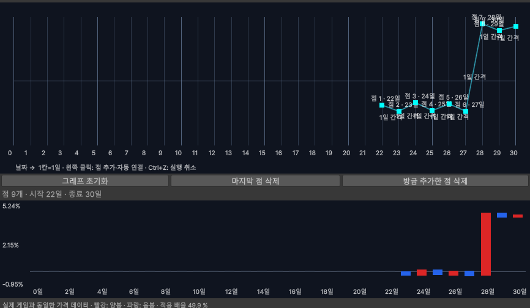

# 기본 패턴
## 공통 규칙
기본 패턴은 총 4가지이다. M,W,박스권, FLAG 등이다. 각 패턴에 공통적으로 적용되는 규칙은 다음과 같다.
- 25일까지 특정 규칙에 의해서 그려진다. 
- 25일 이후(26~30)부터 5일간은 `hidden 구간`이다.
- 패턴의 시작일자는 `0 ~ 5`사이의 랜덤 값을, 구간의 길이는 `10 ~ 25`사이의 랜덤 값을 가진다.
- 시작일자와 구간길이가 정해지면 패턴은 `시작일자 + 구간 길이` 내에서만 그려진다.
- `시작일자 + 구간길이` 로 만들어지는 패턴 종료 일자는 `25일 내에` 있어야 한다. 
- 패턴이 그려지는 구간을 제외한 나머지는 낮은 폭(기업이 지닌 하루 변동폭 * 0.1) %p의 상승 혹은 하락이 그려진다.

`목적`
- 사용자가 어떤 패턴인지 알게되어도 해당 패턴의 수익 구간을 쉽게 유추하지 못하도록 하기 위해서이다.

## M,W자 패턴 변형
1. M과 W가 그려지는 간격과 구성도 랜덤하게 정해진다.
    - M 혹은 W를 그리기 위해서는 점 5개, 최소 10(점 간 최소 간격 2일로 제한)일이 필요하다. 게임 내에서는 이 간격이 랜덤하다.
    - 최소 10일은 점 사이 최소 간격과 별도로 적용한다. 예를 들어 시작 위치가 0일이면 꼭짓점을 0,2,4,6,10일 또는 0,6,8,13,18일에 배치할 수 있다. 꼭짓점 5개 간의 간격은 최소 2일에서 ~ 최대 8일 사이의 간격을 지닐 수 있다.
    - 또한 간격이 랜덤하게 정해져도 결국 위에서 정해진 구간을 벗어난 길이를 갖게 되면 안된다.

`목적`
- 최소 2일을 준 것은 사용자가 적어도 W혹은 M인지를 인식할 필요가 있기 떄문이다. 
- M과 W내 간격도 조정하는 이유는 꺾이는 위치를 쉽게 유추하지 못하게 하기 위해서이다.

## 박스권변형
박스권 패턴은 특정 범위 내에서 위 아래를 반복하는 패턴이다. 해당 범위가 일정하면 `횡보`, 범위가 점점 좁아들어 한 점으로 모이면 `수렴`이라고 한다.
1. 반반의 확률로 박스권은 `횡보` 하거나 `수렴`한다.
    - 횡보와 수렴은 위아래에 그은 선을 그은 것처럼 나아간다.
    - 이때 나아가는 방향은 `각각 33% 확률로` 수평으로, 상승, 하강할 수 있다.
    - 만약 상승한다면 `AUTO,FOOD에 대해서는 20% 확률`로 `AI,BIO, SPACE에 대해서는 50% 확률`로 급락한다.
    - 하강하는 경우는 위와 같은 확률로 상승한다.
2. M과 W와 구분하기 위해서 점이 최소 6개에서 최대 10개가 될 수 있으며 이는 랜덤하게 정해진다.
    - 각 점간의 간격 역시 랜덤하며 해당 간격의 합은 위에서 정해진 구간 길이를 벗어나면 안된다.
## FLAG 변형
FLAG 패턴은 여러 개의 횡보구간을 지니고 각 횡보구간 앞뒤로는 급 상승, 급하락 한다.
1. 횡보 구간의 개수는 최소 1개에서 최대 3개이다.
2. 횡보 구간의 길이는 최소 점 4개에서 최대 8개 사이의 랜덤 구간을 지닌다.
    - 즉 4일에서 8일 중 랜덤한 기간에 거쳐서 그려진다.
3. 횡보 앞뒤로는 무조건 급 상승과 급 하락이 나타나며 해당 급 상승과 급 하락은 1~2일에 거쳐 나타날 수 있다.
4. 횡보 사이의 급등락은 하나의 연결 구간으로 공유한다. 횡보가 N개이면 급등락은 N+1개이다.
5. 횡보 개수를 먼저 뽑고, 각 횡보 길이와 급등락 길이를 랜덤하게 배정한다. 전체 기간이 부족하면 앞선 횡보부터 4일 하한까지 줄여 마지막 횡보의 최소 4일을 확보한다. 그래도 부족하면 급등락 구간을 1일 하한까지 줄인다. 모든 구간은 배정된 기본 패턴 기간 안에서만 그려진다.

## hidden 구간
- 나머지 5일은 정보로 살 수 없는 `hidden 구간`이다.
- BANK를 제외한 나머지 5개의 기업들만 존재한다.
- FOOD와 AUTO는 기업에 설정된 하루 변동폭 × 1.5배의 폭으로 `상승->하락(UpDown)` 혹은 `하락->상승(DownUp)`한다.
    - 26~30일의 각 하루 상승·하락 폭에 적용하며, 1bps 미만의 소수는 반올림한다. 기본 설정 기준 FOOD는 하루 ±7.5%p, AUTO는 하루 ±10.5%p이다.
    - 기업의 안정성을 반영해서 무조건 하락-> 상승 혹은 상승-> 하락 이 2가지 흐름만 나타나며 언제 상승하고 언제 하락하는지는 랜덤이다.
- AI, BIO, SPACE의 hidden은 Decline, Lightning, Crash만 자동 생성한다. Decline의 각 하루 등락과 Lightning·Crash의 급변 폭은 기업의 하루 변동폭 × 2배로 고정한다. 기본 설정 기준 AI는 30%p, BIO는 40%p, SPACE는 50%p이다.
    - 60% 확률로 `하락 흐름`이 나타난다.
    - 10% 확률로 `피뢰침`이 나타난다.
    - 30% 확률로 `대 하락`이 나타난다.
    - `하락 흐름(Decline)`이란 상승과 하락이 섞여있지만 결국에는 26일에 비해선 하락이 나타나는 경우이다.
        - 26일은 2배 폭으로 상승하고, 27~30일에는 상승 1일·하락 3일을 랜덤 배치한다. 전체 5일은 상승 2일·하락 3일이며, 30일은 25일과 26일보다 낮다.
    - `피뢰침(Lightning)`이란 26~30일 중 딱 하루만 매우 급상승한다. 피뢰침이 존재한다면 `22일부터` 미세한 상승과 하락이 반복된다.
        - 급상승 다음 날부터는 높아진 가격대에서 미세한 등락을 이어간다. 원래 가격대로 되돌리는 급락은 추가하지 않는다.
        - 예시는 다음과 같다. 
    - `대 하락(Crash)`이란 미세한 상승과 하락을 반복하다가 쭉 떨어지는 패턴이다.
        - 피뢰침처럼 `22일부터` 미세한 상승과 하락을 반복하다 랜덤한 시작일자를 기준으로 2,3일에 걸쳐 쭉 하락한다. 그 이후는 똑같이 미세한 상승과 하락을 반복한다.

## 생성 순서와 조절 항목
- hidden 유형을 먼저 결정한다. 피뢰침·대 하락이면 22일부터 전조를 배치하고 기본 패턴의 종료일은 21일 이하로 제한한다. 다른 경우 기본 패턴은 25일 이하로 제한한다.
- 남은 날짜 안에서 시작일 0~5일과 기본 패턴 길이 10~25일을 선택한다. FLAG는 선택한 횡보 개수의 최소 구성을 수용할 수 있는 길이만 선택한다.
- 기본 패턴 급등락 하루 변동폭은 기업의 통상 하루 변동폭 × 3배를 기본으로 한다. 패턴 실험실 상단의 `급등락 배율`에서 변경하고 `변동폭·배율 저장`으로 새 게임에 적용한다. AI/BIO/SPACE의 hidden 급변은 이 배율과 별도로 2배이며, FOOD/AUTO의 hidden 반전은 1.5배이다. 전조·급변 이외의 미세 등락은 0.1배를 유지한다.
- 같은 시드·턴·기업·설정이면 실험실과 실제 게임에서 같은 그래프를 생성한다.
- 패턴 실험실의 hidden 선택과 모든 비교 모드는 기업별 출현 제한을 따른다. AI/BIO/SPACE는 Decline·Lightning·Crash, FOOD/AUTO는 UpDown·DownUp, BANK는 없음만 표시한다. 기업 전환 후 허용되지 않는 이전 선택은 자동으로 초기화한다.

## 정산 기준
- 주식 정산은 보유한 날짜의 일별 변동 %p를 합산한다. 가격 비율이나 턴 내 복리를 적용하지 않는다.
- 예를 들어 차트가 +20%에서 +25%로 이동한 날의 수익률은 +5%p이다. 턴 시작 자산의 슬롯별 배정액에 이 변동폭을 적용한다.
- 누적 차트가 -100%를 지나더라도 나눗셈 없이 변동폭을 계산한다. 기존의 기업별 손실률 하한 -100%와 최종 자산 0 하한은 유지한다.
